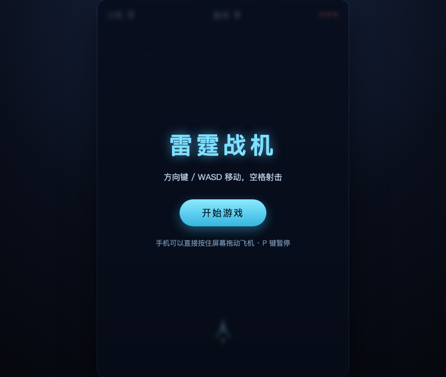
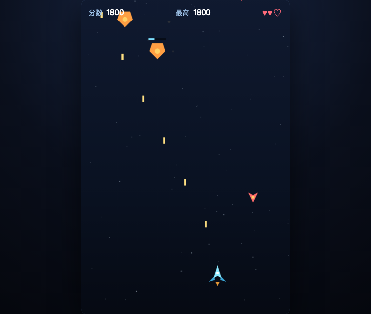

# 雷霆战机（网页小游戏）

用 HTML5 Canvas + 原生 JavaScript 写的飞机大战小游戏，课程练习作品。

不用任何框架、不用打包工具，一个 `index.html` 双击就能玩。

🎮 **在线试玩**：<https://yfwwwwww.github.io/thunder-fighter/>



## 玩法

| 操作 | 说明 |
| --- | --- |
| ← → ↑ ↓ 或 WASD | 移动飞机 |
| 空格 | 射击（按住连发） |
| 手机 | 按住屏幕拖动飞机，同时自动开火 |
| P | 暂停 / 继续 |

- 三条命，被敌机撞到或被打中掉一条，无敌 1.6 秒
- 打死敌机加分：小飞机 100、中型机 200、精英机 500
- 掉落道具：**P** 升级火力（单发 → 双发 → 三发），**S** 加一层护盾（挡一次伤害）
- 分数会存在浏览器本地，下次打开还能看到最高分



## 怎么运行

**方式一（最简单）**：双击 `index.html`，用浏览器打开就能玩。

**方式二（本地起服务，手机也能玩）**：

```bash
cd thunder-fighter
python3 -m http.server 8090
```

然后浏览器打开 <http://localhost:8090>。手机连同一个 WiFi，用电脑的局域网 IP 访问 8090 端口即可。

## 用到的技术

都是课上学过的东西，没有用框架：

1. **Canvas 2D 绘图**：飞机、子弹、敌机、爆炸都是代码画出来的形状，没有用图片素材
2. **游戏主循环**：`requestAnimationFrame` + 时间差 `dt`，保证不同刷新率的屏幕速度一致（不是"每帧移动固定像素"）
3. **对象与数组管理**：子弹、敌机、粒子都是普通对象放在数组里，遍历更新、倒着遍历删除
4. **碰撞检测**：矩形包围盒判断（`Math.abs(a.x - b.x) < 宽度和/2`）
5. **粒子效果**：爆炸时生成一堆随机方向的小圆点，速度逐渐衰减、生命结束就删掉
6. **localStorage**：存最高分
7. **响应式**：Canvas 内部分辨率固定 480×720，CSS 按比例缩放，手机上也能全屏玩

## 目录结构

```
thunder-fighter
├── index.html          页面结构
├── css/style.css       样式
├── js/game.js          游戏逻辑（全部在这一个文件里）
└── screenshots/        运行截图
```

## 代码是怎么组织的

`game.js` 大概分四块：

```
状态与数据      玩家、子弹、敌机、粒子、道具的数组，以及分数、生命这些变量
update(dt)     每帧更新位置、刷怪、判断碰撞
draw()         每帧根据数据画一遍画面
loop()         requestAnimationFrame 主循环，计算 dt 后调用 update + draw
```

## 已知可以改进的地方

- 还没有 BOSS 战，后期难度只是靠刷怪变快
- 没有音效（加 Web Audio 会更爽）
- 最高分只存在本地，没有排行榜（要做排行榜得有后端）


